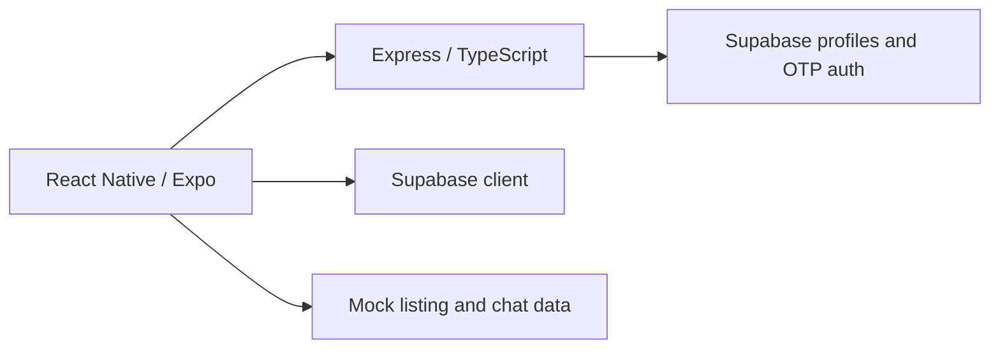

# RUThrift — Rutgers marketplace

A collaborative Rutgers Mobile App Development Incubator project, built by a four-person team. The app explores a Rutgers-exclusive marketplace with a React Native / Expo frontend and an Express / TypeScript backend using Supabase.

## What is implemented in this snapshot

- Supabase-backed profile upsert and email OTP request/verification routes in [backend/routes/users.ts](backend/routes/users.ts).
- A bearer-session check for the email-verification route.
- React Native screens for sign-in, sign-up, accounts, listings, and conversations.
- API host selection for Expo devices and Android emulators.

**Implementation boundary:** listings and conversation interfaces include mock data. In particular, the checked-in chat screen reads mock messages and appends new messages to local React state; it does not establish a complete persisted messaging backend. The `mock backend/` directory contains mock services and hooks. Screen presence should not be read as proof of production-ready backend functionality.

## Architecture



## Local setup

Prerequisites: Node.js/npm, an Expo-compatible development environment, and your own Supabase project.

1. In `backend/`, run `npm install` and copy `.env.example` to `.env`.
2. Configure the server-only Supabase URL and service-role key. Never put a service-role key in the mobile client or commit it.
3. Configure the `profiles` schema and email OTP behavior expected by the route handlers. Schema migrations and a complete reproducible database setup are not included in this snapshot.
4. Run `npm run dev` in `backend/` (default port 3000).
5. In `frontend/`, run `npm install`, copy `.env.example` to `.env`, and set `EXPO_PUBLIC_API_URL` to a host reachable by your device. A physical phone cannot use the computer’s localhost address.
6. The frontend Supabase client currently contains a project URL and a public anonymous key in `frontend/src/lib/supabase.ts`. Configure these for your own project before running against your own backend. Anonymous keys are public client identifiers; authorization depends on database row-level policies.
7. Run `npm start` in `frontend/` to start Expo.

Checks defined by the repository:

```sh
# backend/
npm run build

# frontend/
npm run typecheck
```

These instructions are source-verified, not a claim that database provisioning or device execution was independently reproduced during the documentation audit.

## Project presentation

This repository currently has no verified public demo or committed application screenshots. Add authentic screen captures and database migrations when they can be shared. Do not substitute mock UI behavior for a claim of fully integrated listings or messaging.

## Team and scope

Ayra Agrawal’s resume describes backend work on authentication, profiles, and marketplace integration during February–May 2026. This is a team project; the repository does not attribute every screen or service to one person.
